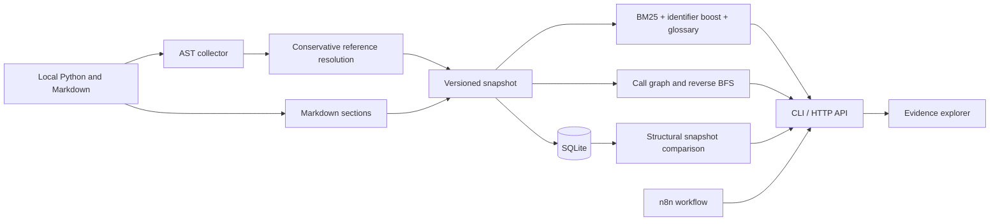

# Architecture and decisions

## Data contract

A symbol ID is `relative/path.py::Qualified.name`. It stays stable across line shifts,
but not moves or renames. A document ID is `relative/path.md:heading_line`, tied to its
snapshot. Every edge stores source, target, call line, expression and resolution reason.

AST fingerprints hash `ast.dump(..., include_attributes=False)`. Whitespace, source
positions and comments are excluded; docstrings and nested bodies are included.
A nested edit can therefore mark its enclosing definition as modified as well.

SQLite stores the JSON snapshot for exact replay and normalized tables for analysis.
All inserts occur in one transaction. Foreign keys tie edges to indexed symbols.
SQLite reads use separate connections, allowing threaded HTTP requests. Scan requests
are serialized; overlapping scans return HTTP 409.

## Resolution policy

1. Collect definitions and explicit imports across all Python files.
2. Resolve direct receiver references such as `self.method`, import aliases and lexical names.
3. Prefer the closest lexical scope. Treat locally rebound names as unknown.
4. Keep unresolved expressions with evidence instead of guessing from a global name match.

A direct receiver reference is still conditional on runtime dispatch. Inheritance,
re-exports and constructor/instance inference need additional analysis. See README.
The graph is a syntactic navigation aid, not a sound/complete Python call graph.

## Retrieval

Tokenization splits snake_case and camelCase and removes a small stop-word set.
BM25 uses k1=1.5 and b=0.75. The hybrid method adds 1.5 per matching identifier/title
term and expands Russian query prefixes using a versioned glossary. All record types
share a retrieval pool. Scores are ranking values, not probabilities or confidence.

A search with no matches returns an empty list. Document linking runs the same
retriever using the symbol name and docstring; it does not infer semantic entailment.

## Deliberate choices

- Standard library first: deterministic offline execution without model downloads.
- SQLite: no separate database process for a single-user local tool.
- Plain HTML/CSS/JS: inspectable UI without a Node build toolchain.
- Extractive evidence: source citations are intrinsic, with no generated claims.
- HTTP service is bound to loopback by default. Docker publishes only loopback ports.
- API analyzes one directory selected at launch; HTTP clients cannot request arbitrary paths.

## HTTP API

| Method | Path | Meaning |
|---|---|---|
| GET | `/api/health` | Service status |
| GET | `/api/snapshot?run=ID` | Current or selected snapshot, with source excerpts |
| GET | `/api/search?q=...&method=hybrid&run=ID` | Ranked evidence |
| GET | `/api/impact?symbol=...&direction=callers&depth=5&run=ID` | Caller/callee paths |
| GET | `/api/runs` | Last 100 stored run summaries |
| GET | `/api/compare?before=ID&run=ID` | Structural changes and review candidates |
| POST | `/api/scan` | Re-index the configured directory; JSON body `{}` |

Use URL encoding for symbol IDs. Invalid parameters return 400; forbidden origins or
hosts return 403. POST requires application/json. No arbitrary path/file-serving route
exists. Source is HTML-escaped before display and the UI has a restrictive CSP.

## Operational limits

The index is in memory during search. BM25 scans all records, and HTTP requests rebuild
the index from the snapshot. This favors clarity over large-repository throughput.
The root can change while being scanned: snapshots are not filesystem transactions.
For reproducible comparisons, index stable checkouts. The local server has no user
authentication and must not be exposed as a public service.
